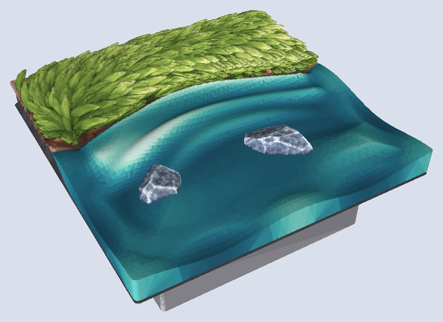

<p align="center">
  
</p>

# dharmatiles

3D-printable tabletop terrain tiles from a few lines of text.

You describe a tile in a short `.dtile` document: where the lines run, which regions they make, and what goes in each one. `dharmatiles` grows the geometry from that description (dirt with clods and pebbles, grass that parts round rocks, water that ripples off its shores, stone walls, cliffs, trees) and writes an STL that prints base down with no supports.

```kdl
tile size="1x1" seed=97 {
    line shore wobble=5 { through "0,0.38" "1,0.42" }
    region pool { boundedBy shore; fill "0.5,0.25" }
    region bank { boundedBy shore; fill "0.5,0.75" }
    stack {
        dirt at=bank
        grass at=bank
        ground at=pool level="water - 2.2"
        scatter at=pool count=2 { rock size="6..10" }
        water
    }
}
```

<p align="center">
  
</p>

Tiles fit the 35 mm DungeonBlocks grid or 25.4 mm OpenLOCK, from the same document.

## Why

Most terrain tools place objects: a rock here, grass there, a tree nearby. The result looks assembled. dharmatiles treats a tile as a place where things affect each other. Rocks are bedded into the ground, grass grows up to them and flows round them, water takes its shoreline from the land, and bare earth shows where it would. The geometry is a consequence of the description, not a list of placements.

Every tile passes a printability gate before it is written: watertight, nothing lost, and no overhang past what a home FDM printer can bridge. Overhang shows red in every render.

## Install

You need [Rust](https://rustup.rs) and git:

```bash
git clone https://github.com/shawn-vincent/dharmatiles.git
cd dharmatiles
cargo build --release
./target/release/dharmatiles          # opens the preview: your tiles and the library
```

## Use

```bash
dharmatiles                                   # browse your tiles (~/dharmatiles) and the library in the browser
dharmatiles preview my-tile.dtile --open      # live painted view; rebuilds on every save
dharmatiles build my-tile.dtile               # -> out/db/my-tile-db.stl
dharmatiles build my-tile.dtile --system ol   # for OpenLOCK
dharmatiles build --all                       # every library tile (one target per run: --system, --printer)
dharmatiles check my-tile.dtile               # read and plan only
dharmatiles elements                          # the elements and their controls
```

## Documentation

The site under `docs/` is the reference: the [language guide](docs/language.html) (a map of one page for each idea in [docs/guide/](docs/guide/)), one page per [element](docs/elements/index.html), [composing a tile](docs/composing.html), the [tile system](docs/standards/tile-system.html), [printing](docs/standards/printing.html) and the [rules](docs/standards/rules.html).

## Layout

```text
crates/     the program, in Rust: dt-geom, dt-kit, dt-elements, dt-doc, dt-eval, dharmatiles
library/    the shipped tiles, shared parts, printers and palettes (.dtile documents)
docs/       the site
web/        the preview's page
xtask/      repo chores: cargo xtask docs | pictures | sheet
extras/     a paint organizer and STL helpers (Python, not part of the program)
```

## Licence

Everything here, the code and the tile library, is under the [Peer Production License](LICENSE) (https://wiki.p2pfoundation.net/Peer_Production_License), a copyfarleft licence drawn from CC BY-NC-SA: free to use, change and share non-commercially with credit, under the same licence; commercial use only by worker-owned co-operatives that share their gains among the worker-owners. Manifold, built in through `third_party/manifold-csg-sys`, keeps its own Apache-2.0 and MIT licences there.

OpenLOCK is by Printable Scenery, under CC BY-NC 4.0.
